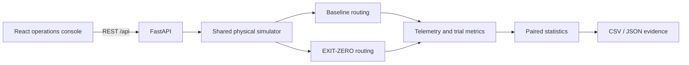

# EXIT-ZERO

**Adaptive emergency evacuation digital twin — INNOVEX 2026 research prototype**

EXIT-ZERO compares conventional safety-aware shortest-path evacuation with predictive, congestion-aware routing inside the same deterministic crowd simulator. The system combines a FastAPI simulation engine with a React operations console, reproducible paired-seed experiments, and CSV/JSON evidence exports.

> EXIT-ZERO is a research simulation. It is not a certified life-safety system, fire model, crowd-injury model, or substitute for evacuation engineering and emergency services.

## What is working

- Deterministic occupant generation and replay from a random seed.
- Continuous speed-density deceleration and capacity-limited FIFO exit queues.
- Baseline shortest-path routing that reacts when a physical exit becomes unavailable.
- EXIT-ZERO multi-objective routing with congestion inflow lookahead, hazard costs, accessibility constraints, replanning cadence, and hysteresis.
- Interactive floor plan with live occupants, routes, hazards, queues, density, exit blocking, and telemetry.
- Paired multi-seed experiment jobs with bootstrap intervals, sign-flip tests, evidence-strength labels, and CSV/JSON export.
- Separate Python-heap and process-RSS memory measurements.
- Wheelchair completion and evacuation-time telemetry for accessibility claims.

## Evidence snapshot

The strongest saved result is the congested-corridor experiment with 200 occupants and 20 paired seeds (101–120):

| Measure | Baseline | EXIT-ZERO | Paired result |
| --- | ---: | ---: | ---: |
| Mean total evacuation time | 84.45 s | 72.92 s | 11.53 s lower (13.65%) |
| 95% bootstrap interval for the mean difference | — | — | 6.5 to 16.6 s |
| Paired outcomes | 3 wins | 16 wins | 1 tie |

The saved Phase 4 artifact reports `p = 0.0001`. Reproduction should be performed on the target machine before submission.

Important limits:

- The rerun 500-occupant result used only three seeds: 231.83s baseline versus 131.67s adaptive, 100.17s paired mean reduction, exact `p = 0.25`. It is preliminary, not the principal claim.
- Mixed mobility was slower on total clearance in the 20-seed result, and the Phase 5 rerun found mean wheelchair evacuation time 0.64s slower under adaptive routing. Present it as a regression and optimization target.
- Historical `<35 MB` values were Python allocation-trace results, not process RSS. New exports label Python heap and sampled RSS separately.
- Simulation findings do not establish real-world safety performance.

## Architecture



Both strategies use the same movement, queue, hazard-event, spawn, mobility, and seed substrate. Only route selection differs.

## Repository map

```text
backend/
  app/api/             REST endpoints
  app/experiments/     paired runner, statistics, jobs, exports
  app/models/          Pydantic state and building models
  app/simulation/      graph generation and simulation engine
  tests/               backend and fairness regression tests
frontend/
  src/components/      digital twin, controls, demo, evidence dashboard
  src/services/        API client
scenarios/             versioned scenario definitions
experiments/           saved CSV/JSON evidence artifacts
docs/                  architecture, validation, demo, deployment
submission/            hackathon-ready copy and judging notes
```

## Run locally

Prerequisites: Python 3.11+ and Node.js 20+.

Backend (PowerShell):

```powershell
cd backend
python -m venv .venv
.\.venv\Scripts\python.exe -m pip install -r requirements.txt
$env:PYTHONPATH = "..\backend"
.\.venv\Scripts\python.exe -m uvicorn app.main:app --reload --port 8000
```

Frontend, in a second terminal:

```powershell
cd frontend
npm ci
npm run dev
```

Open `http://localhost:5173`. The Vite development server proxies `/api` to `http://localhost:8000`.

## Verify

```powershell
$env:PYTHONPATH = "backend"
backend\.venv\Scripts\python.exe -m pytest backend\tests -q

cd frontend
npm run lint
npm run build
```

Official primary sweeps:

```powershell
$env:PYTHONPATH = "backend"
backend\.venv\Scripts\python.exe backend\run_phase4_validation_sweep.py
```

Population scaling (including the preliminary three-seed 500-person case):

```powershell
$env:PYTHONPATH = "backend"
backend\.venv\Scripts\python.exe backend\benchmark_phase4.py
```

Each scaling result is now saved as CSV and JSON instead of existing only in terminal output.

## Judge demo

Use the in-app **Interactive Demo** and follow [docs/demo_script.md](docs/demo_script.md). The flow loads configurations but never substitutes stored numbers for a live run. Finish in the Evidence Lab with the 20-seed result and limitations.

## Deployment

See [docs/deployment.md](docs/deployment.md) for same-origin and split frontend/backend deployment, required environment variables, verification, and rollback guidance.

## Documentation

- [Architecture](docs/architecture.md)
- [Phase 3 predictive intelligence](docs/phase3_predictive_intelligence_report.md)
- [Phase 4 experimental validation](docs/phase4_experimental_validation.md)
- [Phase 5 evidence audit](docs/phase5_evidence_audit.md)
- [Demo script](docs/demo_script.md)
- [Deployment guide](docs/deployment.md)

