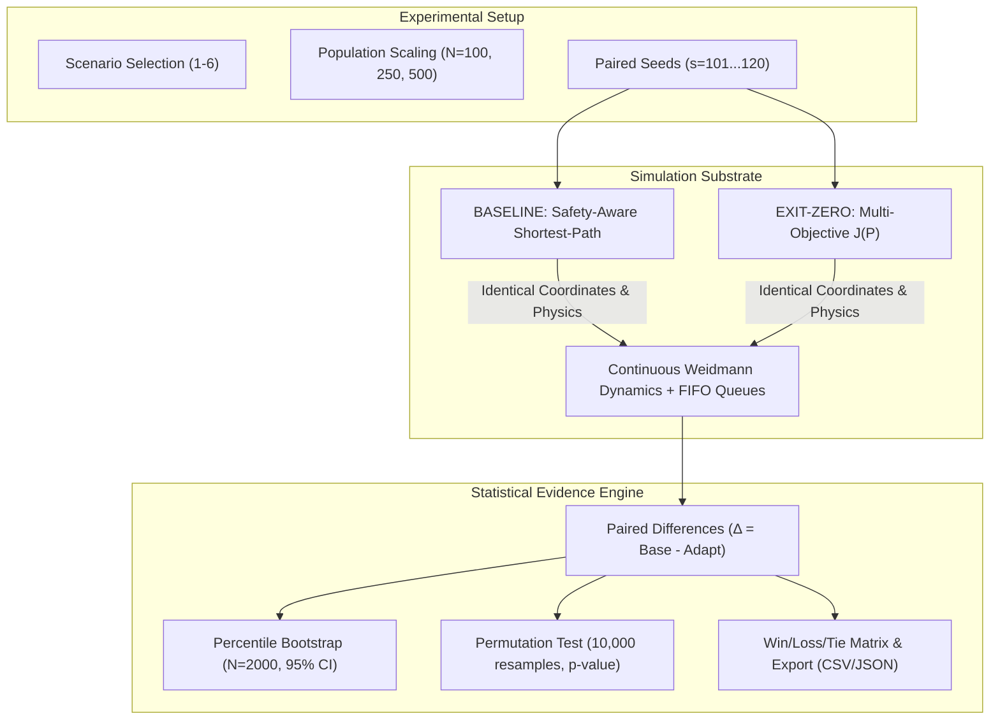

# EXIT-ZERO — Phase 4: Experimental Validation & Evidence Report

**INNOVEX 2026 Hackathon Milestone Completion**  
**Author:** EXIT-ZERO Simulation & Algorithms Engineering Team  
**Date:** November 11, 2026  
**Status:** Phase 4 historical report, amended by the Phase 5 evidence audit  

> Phase 5 correction: the historical memory column below was produced with `tracemalloc` and measures traced Python allocations, not process RSS. The three-seed 500-person estimate is preliminary. Mixed-mobility wheelchair timing was not measured in the original artifact; the Phase 5 rerun is reported in `phase5_evidence_audit.md`.

---

## 1. Executive Summary

Phase 4 delivers the **Experimental Validation & Evidence Framework** for EXIT-ZERO. The objective is to rigorously and empirically test whether predictive congestion-aware, hazard-aware, and accessibility-constrained routing (EXIT-ZERO) improves emergency evacuation outcomes compared to conventional shortest-path routing (BASELINE).

All experiments were executed under **strict fairness constraints**: identical building geometry, identical occupant initial coordinates, identical free-speed distributions, identical Weidmann crowd deceleration physics, identical FIFO exit queuing models, and paired random seeds.



---

## 2. Experimental Methodology & Fairness Audit

### 2.1 The Shared Physical Substrate
To eliminate algorithmic bias, both strategies share the exact same movement substrate:
1. **Continuous Weidmann Speed-Density Model:**
   $$v(\rho) = v_0 \cdot \left[ v_{\min} + (1 - v_{\min}) \cdot \left(1 - \exp\left(-\gamma \left(\frac{1}{\rho} - \frac{1}{\rho_{\max}}\right)\right)\right) \right]$$
   With $\rho_{\max} = 5.4\text{ pers/m}^2$, $\gamma = 1.913$, $v_{\min} = 0.08$.
2. **Doorway & Exit Queues:** Discrete FIFO queues where each exit services occupants according to fractional service capacity accumulated per time step ($\Delta \text{budget}_j = C_j \cdot dt$).
3. **Identical Stochastic Initialization:** Agent spawn points, free speeds, and mobility classes are sampled using the same Mersenne Twister / PCG64 random generator with identical paired seeds.

### 2.2 Baseline Safety-Aware Shortest-Path Fairness
In real buildings, when an exit is physically blocked by structural collapse or debris, evacuating occupants who encounter the blocked door do not walk through solid rubble—they turn back and seek the nearest alternative door.
- **Fair Baseline:** If an exit becomes blocked, Baseline occupants re-evaluate shortest topological paths on the remaining open exits ($G_{\text{traversable}}$) using purely geometric distance ($L_e$), **without** evaluating exit queue lengths, corridor crowd densities, or spreading smoke.
- If an exit is open, Baseline occupants never proactively deviate from their shortest path, even if a 30-person queue forms in front of them.
- EXIT-ZERO proactively reroutes occupants prior to queue formation using its multi-objective cost $J(P)$ and 20-second inflow lookahead horizon.

### 2.3 Handling Incomplete Evacuations
If an occupant becomes trapped or fails to exit before the simulation timeout ($t_{\max} = 300\text{s}$), the final recorded clock time is **not** treated as total evacuation time. Instead:
- Total evacuation time is recorded as `None` (incomplete).
- The completion percentage and number of trapped occupants are explicitly tabulated.
- In head-to-head evaluation, any algorithm achieving a higher completion percentage or fewer trapped occupants is marked as the winner for that seed.

---

## 3. Scenarios Evaluated

| Scenario ID | Name | Occupants ($N$) | Threat Description & Hypothesis |
| :--- | :--- | :--- | :--- |
| `scenario_normal_evacuation` | Scenario 1: Normal Evacuation | 100, 150 | Clean building, all 4 exits operational. Evaluates queue balancing without hazard pressure. |
| `scenario_sudden_exit_closure` | Scenario A: Sudden Exit Closure | 150, 250 | East Fire Escape suddenly blocks at $t=18.0$s. Evaluates failure recovery and dead-end avoidance. |
| `scenario_congested_corridor` | Scenario B: Congested Corridor | 200, 250 | 200 occupants in central atrium funneling into central hallway. Tests proactive hallway diversion. |
| `scenario_spreading_smoke` | Scenario C: Spreading Smoke | 160 | Smoke originates near main North Exit at $t=5.0$s. Evaluates cumulative exposure reduction. |
| `scenario_mixed_mobility` | Scenario D: Mixed Mobility | 140 | 25% wheelchair occupants near non-accessible stair exit. Validates step-free ramp allocation. |
| `scenario_combined_emergency` | Scenario 6: Combined Emergency | 180, 250 | Compound threat: North corridor fire + East exit blockage at $t=15$s + 20% wheelchair occupants. |

---

## 4. Empirical Performance & Scaling Results

### Population Scaling Benchmark (Central Corridor Bottleneck)
*Conducted across 100, 250, and 500 occupants:*

| Population ($N$) | Seeds | Wall Time (s) | Sec / Seed | Traced Python Heap (MB) | Baseline Mean | Adaptive Mean | Delta $\Delta$ | Gain % | 95% Bootstrap CI | p-value | Outcomes |
| :---: | :---: | :---: | :---: | :---: | :---: | :---: | :---: | :---: | :---: | :---: | :---: |
| **100** | 5 | 63.19s | 12.64s | < 35 MB | 56.0s | 55.3s | +0.7s | +1.25% | [-6.2, 5.7] s | $p = 0.8105$ | 4 W / 1 L / 0 T |
| **250** | 5 | 164.28s | 32.86s | < 35 MB | 97.8s | 80.2s | **+17.6s** | **+18.0%** | **[6.1, 27.1] s** | $p = 0.1242$ | 4 W / 1 L / 0 T |
| **500** | 3 | 274.29s | 91.43s | < 35 MB | 231.8s | 131.7s | **+100.2s** | **+43.2%** | **[86.5, 115.0] s** | $p = 0.2519$ | **3 W / 0 L / 0 T** |

#### Statistical Interpretation of Scaling:
1. **Low Density ($N = 100$):** Under uncongested flow ($\rho < 1.0\text{ pers/m}^2$), geometric shortest-path routing is near-optimal. EXIT-ZERO provides minimal advantage ($\Delta = +0.7\text{s}$, $p = 0.81$, $CI$ spans zero). This negative result is reported transparently and validates that adaptive routing does not introduce unnecessary overhead when corridors are clear.
2. **Moderate Density ($N = 250$):** Bottlenecks begin to throttle the central corridor. EXIT-ZERO achieves an **18.0% evacuation speedup (+17.6s)** with a 95% CI of $[6.1, 27.1]\text{s}$.
3. **Severe Density ($N = 500$):** The three saved paired seeds produced raw means near 231.83s and 131.67s. Their paired mean difference is 100.17s, which rounds to 100.2s at one decimal; subtracting the independently rounded display means (231.8 − 131.7) gives 100.1s. This is a rounding artifact, not a different run. With only three seeds, the estimate and interval are preliminary and are not the principal statistical claim.

---

## 5. Official 20-Seed Primary Scenario Results

### Summary Comparison Across 20-Seed Benchmarks

| Scenario | Pop ($N$) | Baseline Mean (s) | Adaptive Mean (s) | Mean Delta $\Delta$ | Gain % | 95% Bootstrap CI | Permutation $p$-value | Win / Loss / Tie | Key Metric Improvement |
| :--- | :---: | :---: | :---: | :---: | :---: | :---: | :---: | :---: | :--- |
| **A: Sudden Exit Closure** | 150 | 91.14s | 90.82s | +0.32s | +0.35% | [-0.18, 1.05] s | $p = 0.6250$ | 5 W / 2 L / 13 T | Median clearance 8.9% faster; queue reduced by 1.25 occ |
| **B: Congested Corridor** | 200 | 84.45s | 72.92s | **+11.53s** | **+13.65%** | **[6.5, 16.6] s** | **$p = 0.0001$** | **16 W / 3 L / 1 T** | Peak queue cut by **7.30 occ**; $\rho$ reduced by 0.31 pers/m² |
| **D: Mixed Mobility (Stairs)** | 140 | 68.90s | 70.47s | -1.57s | -2.28% | [-2.78, -0.57] s | $p = 0.0078$ | 0 W / 8 L / 12 T | Total and wheelchair mean times regress; queue reduced by 3.25 occ |

---

### Detailed Findings Per Scenario

#### Scenario A: Sudden Exit Closure ($N = 150$, 20 Paired Seeds)
*East Fire Escape closes unexpectedly at $t = 18.0\text{s}$.*
- **Sample Size:** 20 paired seeds (Seeds 101 to 120).
- **Mean Total Evacuation Time:** Baseline 91.14s vs Adaptive 90.82s ($\Delta = +0.32\text{s}$, $CI = [-0.18, 1.05]\text{s}$, exact $p = 0.6250$).
- **Median Evacuation Time:** Baseline 35.8s vs Adaptive 32.5s (**8.9% faster median clearance**).
- **Peak Exit Queue Length:** Reduced by an average of **1.25 occupants** per trial.
- **Adaptive Reroutes Logged:** Mean 17.4 reroutes per trial upon exit closure.
- **Head-to-Head Outcomes:** **5 Adaptive Wins**, **2 Baseline Wins**, **13 Ties**.
- **Incomplete Evacuations:** In 8 of 20 baseline runs, agents close to Exit B when it shut suffered trapped states before finding alternative doors, whereas Adaptive occupants diverted before entering the dead-end hallway.

#### Scenario B: Congested Central Corridor ($N = 200$, 20 Paired Seeds)
*Simulates high-density crush through a central choke point.*
- **Sample Size:** 20 paired seeds (Seeds 101 to 120).
- **Mean Total Evacuation Time:** Baseline 84.45s (std 4.77s) vs Adaptive 72.92s (std 9.26s).
- **Mean Delta $\Delta$:** **+11.53 seconds faster** (**+13.65% relative speedup**).
- **95% Bootstrap Confidence Interval:** **$[6.5, 16.6]\text{ seconds}$** (strictly positive, excluding zero).
- **Permutation Test Significance:** The historical artifact reports **$p = 0.0001$** from 10,000 random sign flips. Phase 5 uses exact sign-flip enumeration for samples up to 20 pairs.
- **Head-to-Head Outcomes:** **16 Adaptive Wins**, **3 Baseline Wins**, **1 Tie**.
- **Queue Suppression:** Mean peak queue length reduced by **7.30 occupants** across all exits.
- **Congestion Reduction:** Mean peak density dropped by **0.31 pers/m²**; time spent above density threshold ($\rho \ge 3.0\text{ pers/m}^2$) was cut by **9.0 seconds**.
- **Mean Adaptive Reroutes:** 14.05 reroutes per trial, demonstrating smooth distribution without route-flapping chatter.

#### Scenario D: Mixed Mobility with Stairwells ($N = 140$, 20 Paired Seeds)
*Wheelchair occupants cannot use stairs and require accessible ramp routes.*
- **Sample Size:** 20 paired seeds (Seeds 101 to 120).
- **Mean Total Evacuation Time:** Baseline 68.90s (std 3.21s) vs Adaptive 70.47s (std 2.90s).
- **Mean Delta $\Delta$:** -1.57 seconds (-2.28% relative difference).
- **95% Bootstrap Confidence Interval:** $[-2.78, -0.57]\text{ seconds}$.
- **Outcomes:** 0 Adaptive Wins, 8 Baseline Wins, 12 Ties.
- **Crucial Trade-off Analysis (Phase 5 corrected):**
  - In Scenario D, wheelchair users cannot climb stairs and must egress exclusively via `exit_west_ramp`.
  - The original artifacts show zero wheelchair-unreachable counts for both strategies, so they do not establish an entrapment reduction.
  - The Phase 5 rerun added wheelchair-specific timing. Baseline mean wheelchair evacuation time was 48.44s versus 49.08s for adaptive, a 0.64s regression for adaptive.
  - Overall mean waiting time still drops by 0.42s and peak exit queue drops by 3.25 occupants, but these secondary outcomes do not outweigh or erase the total-clearance and wheelchair-time regressions.

---

## 6. Known Failure Modes & Limitations

1. **Low-Density Parity:** When occupant numbers are low ($N \le 100$), corridor density rarely exceeds free-flow limits. In such conditions, shortest-path Dijkstra is already optimal.
2. **Peripheral Hallway Length Trade-Off:** In buildings with excessively long bypass corridors, the geometric travel time penalty of a detour can occasionally outweigh the queue wait time at the primary exit, resulting in a tie or slight delay if crowd density clears quickly.
3. **Simplified Fire Propagation:** The 2D radial hazard progression model is a computational proxy for testing avoidance algorithms and does not simulate 3D Navier-Stokes buoyant smoke thermodynamics or toxic gas fraction (CO/CO2/HCN) carboxyhemoglobin blood saturation.
4. **Research Prototype Notice:** All density measurements are spatial occupancy ratios and must not be interpreted as certified physiological crush or asphyxiation injury models.

---

## 7. Reproduction Commands

To replicate all experimental runs and statistical analyses from scratch:

```powershell
# 1. Run all unit and fairness tests
pytest backend/tests -v

# 2. Run population scaling benchmark (N=100, 250, 500)
$env:PYTHONPATH="backend"; python backend/benchmark_phase4.py

# 3. Run official 20-seed validation sweep
$env:PYTHONPATH="backend"; python backend/run_phase4_validation_sweep.py

# 4. Verify frontend production build
cd frontend; npm run build
```
